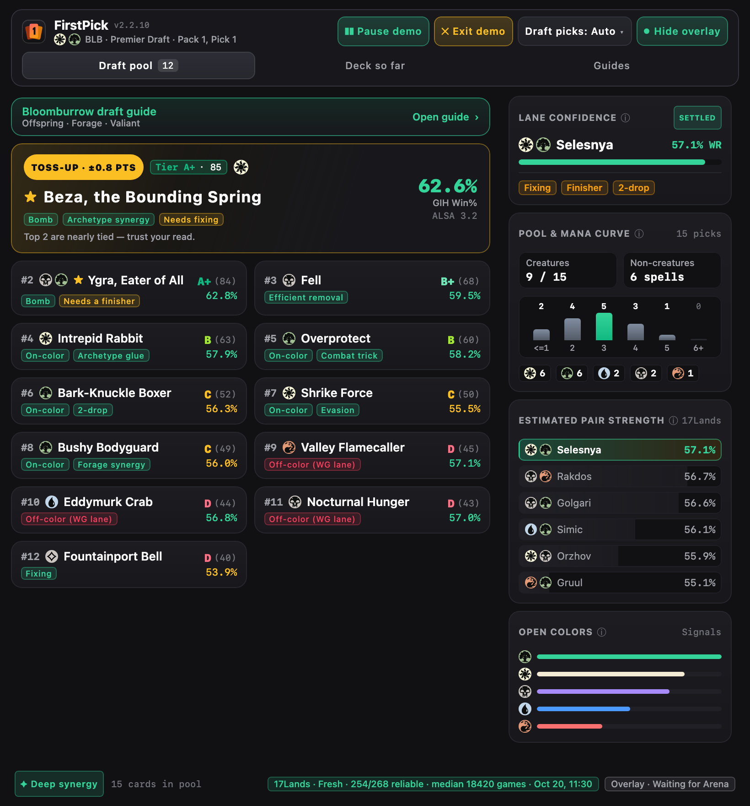
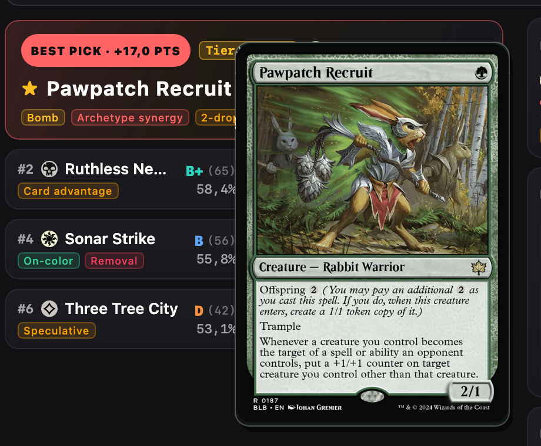
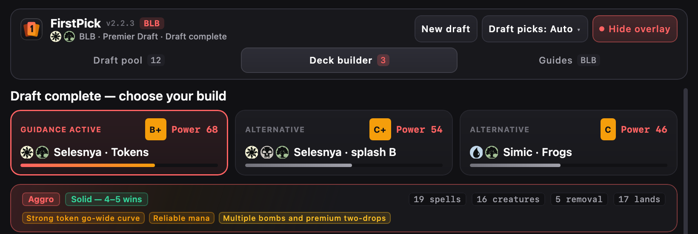
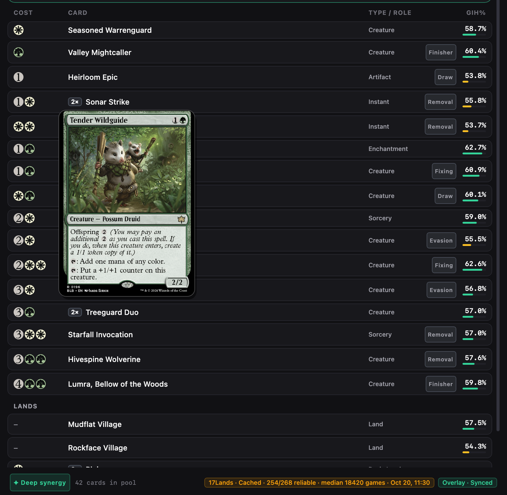

<p align="center">
  <picture>
    
  </picture>
</p>

<p align="center">
  A native macOS draft assistant for <b>Magic: The Gathering Arena</b>, built with Kotlin + Compose Multiplatform.
</p>

FirstPick watches Arena's log during a Draft, ranks every card in the pack using
[17Lands](https://www.17lands.com/) data adjusted to your colors, archetype, curve,
and needs, then proposes 2–3 finished decks when the draft ends.

> Unofficial fan project. Not affiliated with or endorsed by Wizards of the Coast.

<p align="center">
  <picture>
    
  </picture>
</p>

## Features

- **Live pack ranking** — every card graded **A+ → F** with a 0–100 value, best pick on top.
- **Deck-aware scoring** — blends global and in-color win rates, archetype synergy, and missing roles.
- **Dashboard** — likely colors, archetypes, open-color signals, curve, and pool.
- **On-card overlay** — grades drawn directly on Arena's cards, at any window size.
- **Set guides** — color-pair themes and key commons/uncommons per set, with cited sources.
- **Deck builder** — 2–3 ranked builds with manabase, then red/green guidance in Arena's deck builder.

Hover any card to preview it:

<picture>
  
</picture>

After the draft, compare builds and review the full list:

<picture>
  
</picture>

<picture>
  
</picture>

## Install

1. Download the `.dmg` for your Mac (`arm64` for Apple Silicon, `x86_64` for Intel) from
   [**Releases**](../../releases/latest) and drag **FirstPick** to Applications.
2. In Arena, enable **Options → Account → Detailed Logs (Plugin Support)**.
3. For overlays, grant **Screen Recording** permission. Frames are processed locally and never stored or uploaded.

Older or `*-unsigned.dmg` builds may need **Open Anyway** in Privacy & Security, or
`xattr -dr com.apple.quarantine "/Applications/FirstPick.app"`.

## Run from source

```bash
git clone https://github.com/francescolofranco-dev/first-pick firstpick && cd firstpick
native/macos/build.sh   # native capture/OCR helpers
./gradlew run           # needs a full JDK 21
./gradlew runProduction # build, install, and open the production app
```

See [technical notes](docs/technical-notes.md), [CONTRIBUTING.md](CONTRIBUTING.md),
and [distribution](docs/distribution.md) for architecture, builds, and advisor details.

## Attribution

Win-rate data from [17Lands](https://www.17lands.com/) (CC-BY-4.0); card data and mana
symbols from [Scryfall](https://scryfall.com/). Magic: The Gathering is © Wizards of the Coast.

## License

[MIT](LICENSE) © 2026 Francesco Lo Franco
