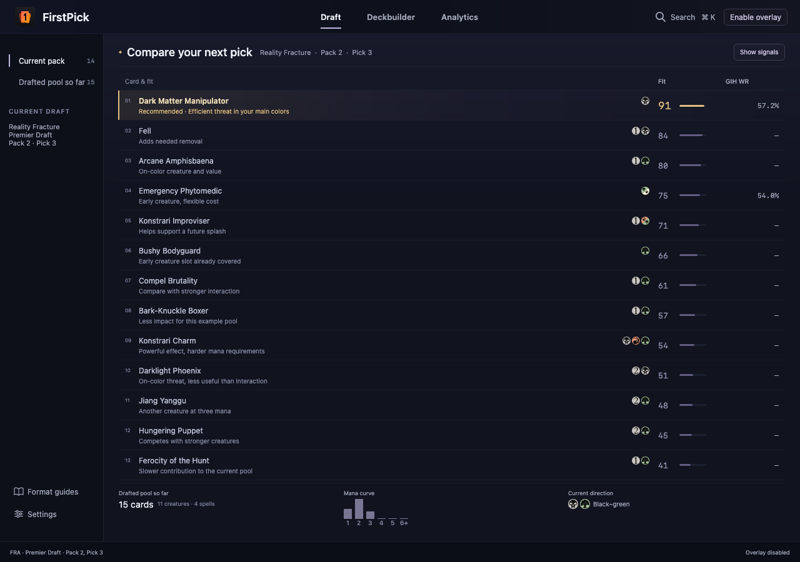
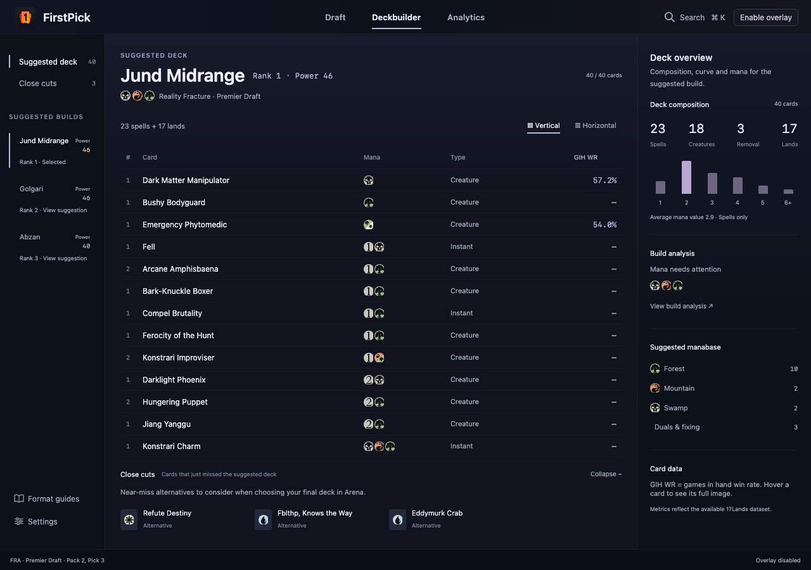
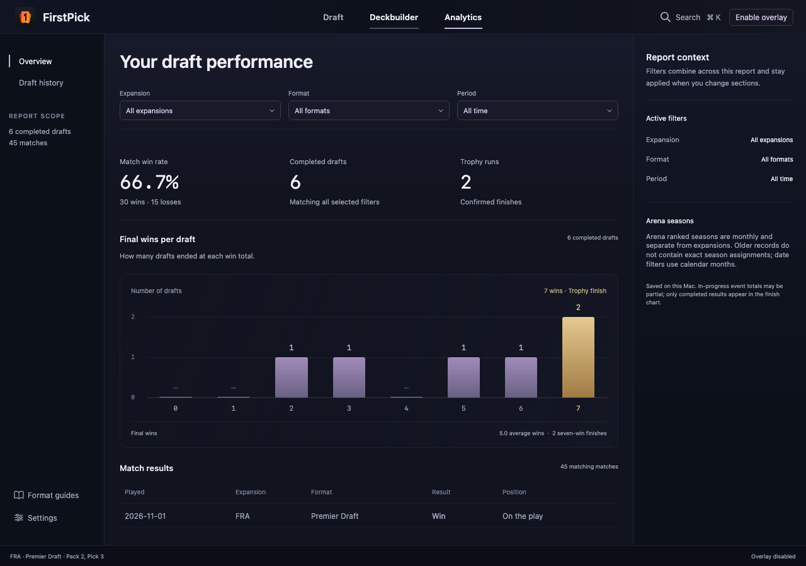
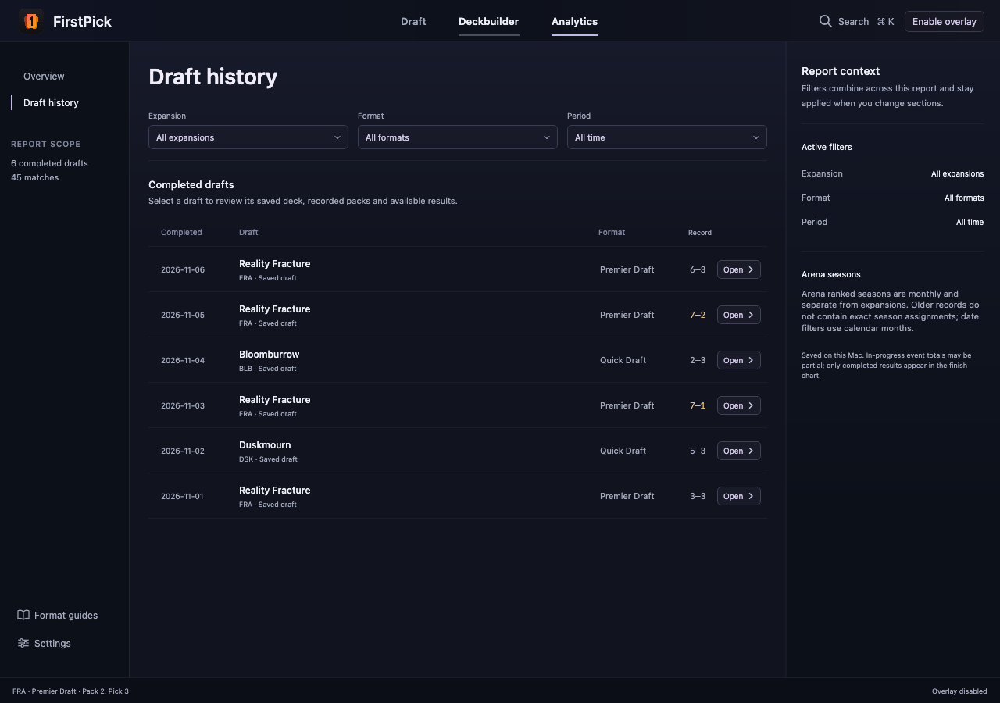

<p align="center">
  <picture>
    
  </picture>
</p>

<p align="center">
  A native macOS draft assistant for <b>Magic: The Gathering Arena</b>, built with Kotlin + Compose Multiplatform.
</p>

FirstPick watches Arena's log during a Draft, ranks every card in the pack using
[17Lands](https://www.17lands.com/) data adjusted to your colors, archetype, curve,
and needs, then proposes 2–3 finished decks when the draft ends.

> Unofficial fan project. Not affiliated with or endorsed by Wizards of the Coast.

<p align="center">
  <picture>
    
  </picture>
</p>

## Features

- **Live pack ranking** — compare 0–100 fit scores, mana costs, available 17Lands win rates, and a reason for each suggestion.
- **Deck-aware scoring** — blends global and in-color win rates, archetype synergy, and missing roles.
- **Draft workspace** — switch between the current pack and drafted pool; check your curve, color direction, and draft signals.
- **Deckbuilder** — compare up to three ranked builds, review close cuts, and inspect the curve and suggested manabase in vertical or horizontal layouts.
- **Arena overlay** — pick ratings and deck guidance alongside Arena, with read-only memory access for supported game builds.
- **Format guides** — color-pair themes and key commons/uncommons per set, with cited sources for researched guides.
- **Analytics and draft history** — local performance reports, expansion/format/period filters, and saved drafts with recorded cards, packs, and available results. Recover available records from older Arena logs automatically.
- **Automatic set releases** — upcoming Arena sets are checked regularly, with new support and ratings-ready updates published as data becomes available. FirstPick notifies you when a new app version is ready.

## A look inside

Compare suggested builds, close cuts, and mana in **Deckbuilder**:

<picture>
  
</picture>

Track results in **Analytics**, then open a saved draft to review its deck, recorded packs, and results:

<picture>
  
</picture>

<picture>
  
</picture>

Screenshots show the current app UI with illustrative sample data.

## Keeping up with new sets

FirstPick follows upcoming Magic releases and starts checking for Arena card pools
before release day. New set support is published automatically as cards become
available, followed by a ratings update once enough 17Lands results exist. Early
support uses card information and provisional themes; researched guides take
precedence where available.

The app checks for new versions and shows **Update available** with a download
link. Installing the new version is a manual step. See the
[set-update notes](docs/technical-notes.md#new-sets-and-updates) for details.

## Install

1. Download the `.dmg` for your Mac (`arm64` for Apple Silicon, `x86_64` for Intel) from
   [**Releases**](../../releases/latest) and drag **FirstPick** to Applications.
2. In Arena, enable **Options → Account → Detailed Logs (Plugin Support)**.
3. Enable the overlay and click **Grant Arena access** in FirstPick. Complete the macOS administrator prompt for temporary read-only access. The current supported memory layout is Arena **2026.64.50 on Apple Silicon**; unsupported builds pause the overlay. Screen Recording is not used. The dashboard still works without memory access.

Older or `*-unsigned.dmg` builds may need **Open Anyway** in Privacy & Security, or
`xattr -dr com.apple.quarantine "/Applications/FirstPick.app"`.

## Run from source

```bash
git clone https://github.com/francescolofranco-dev/first-pick firstpick && cd firstpick
native/macos/build.sh --host # native window-metadata and read-only memory helpers
./gradlew run           # needs a full JDK 21
./gradlew runProduction # build, install, and open the production app
```

See [technical notes](docs/technical-notes.md), [CONTRIBUTING.md](CONTRIBUTING.md),
and [distribution](docs/distribution.md) for architecture, builds, and advisor details.

## Attribution

Win-rate data from [17Lands](https://www.17lands.com/) (CC-BY-4.0); card data and mana
symbols from [Scryfall](https://scryfall.com/). Magic: The Gathering is © Wizards of the Coast.

## License

[MIT](LICENSE) © 2026 Francesco Lo Franco
